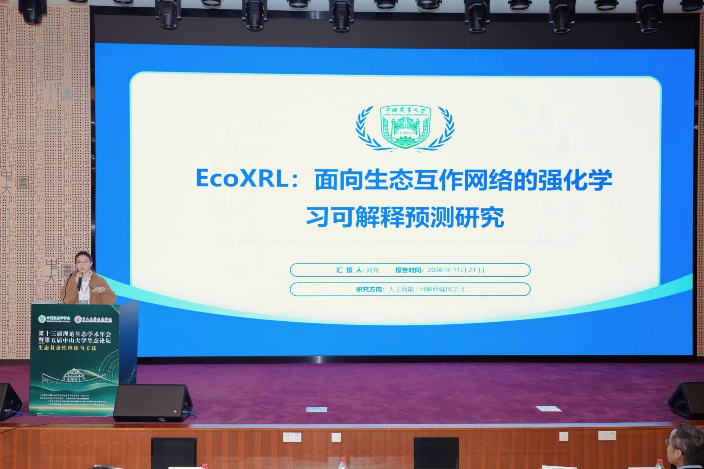

Members of Lei's Lab attended the 13th Annual Meeting of Theoretical Ecology, held in Shenzhen on November 20, 2026. Prof. Lei Zhao, postdoctoral researcher Yao Liu, and PhD student Yijun Ren represented the lab at the meeting.

Yao Liu gave an oral presentation on the lab's recent work.

It was a great opportunity to exchange ideas and build collaborations — we look forward to next year's meeting!
